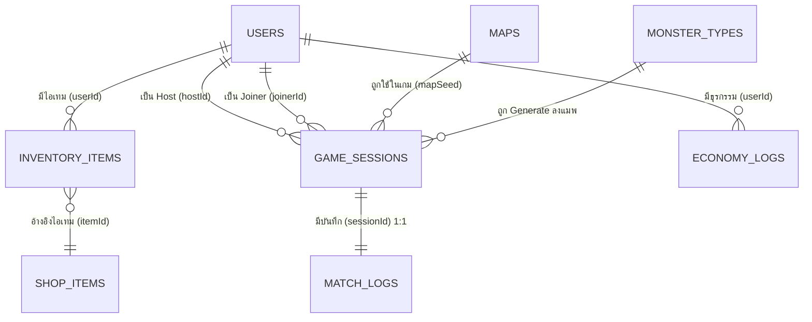

# 🗄️ Database Complete Reference — Code in the Dark
> เอกสารอ้างอิงโครงสร้าง Database ฉบับสมบูรณ์
> อัปเดตล่าสุด: 2026-09-06 | จำนวน Collections: 8

---

## 📊 ภาพรวมระบบ

| รายการ | รายละเอียด |
|---|---|
| **Database** | MongoDB Atlas (Free Tier — 512MB) |
| **ODM** | Mongoose (Node.js / TypeScript) |
| **จำนวน Collections** | 8 Collections |
| **Authentication** | Google OAuth 2.0 อย่างเดียว |
| **Map System** | Seed-based Generation (Deterministic) |
| **Log System** | Obstacle events → SYSTEM messages ใน MatchLogs |

### 🗂️ แผนผังรวม 8 Collections

```
┌─────────────────────────────────────────────────────────────┐
│  Core / Master Data                                         │
│  ┌──────────┐  ┌────────────┐  ┌───────────────┐           │
│  │  USERS   │  │ SHOP_ITEMS │  │ MONSTER_TYPES │           │
│  └──────────┘  └────────────┘  └───────────────┘           │
│                                                             │
│  ┌──────┐                                                   │
│  │ MAPS │  (เก็บแค่ seed + สถิติ)                          │
│  └──────┘                                                   │
├─────────────────────────────────────────────────────────────┤
│  Transactional                                              │
│  ┌───────────────┐  ┌──────────────┐  ┌──────────────────┐ │
│  │ GAME_SESSIONS │  │  MATCH_LOGS  │  │  ECONOMY_LOGS    │ │
│  └───────────────┘  └──────────────┘  └──────────────────┘ │
│                                                             │
│  ┌─────────────────┐                                        │
│  │ INVENTORY_ITEMS │  (Junction: Users ↔ ShopItems)         │
│  └─────────────────┘                                        │
└─────────────────────────────────────────────────────────────┘
```

---

## 🔗 ER Diagram



---

## 1. 👤 `USERS` — ข้อมูลผู้ใช้งาน

### หน้าที่
ศูนย์กลางของระบบทั้งหมด เก็บข้อมูลผู้เล่นที่ Login ผ่าน Google OAuth ไม่มีระบบ Username/Password

### เหตุผลที่เลือก Google OAuth อย่างเดียว
- ไม่ต้องจัดการ Password Hashing เอง
- Google ดูแลความปลอดภัยให้ทั้งหมด
- ลดความซับซ้อนของโค้ด

### Fields

| Type | Field | Index | Required | Default | หมายเหตุ |
|---|---|---|---|---|---|
| ObjectId | `_id` | PK | Auto | — | สร้างอัตโนมัติโดย MongoDB |
| String | `googleId` | Unique | ✅ | — | ID จาก Google OAuth เช่น `"113205819283746512345"` |
| String | `displayName` | — | ✅ | — | ชื่อจาก Google Account |
| String | `email` | Unique | ✅ | — | Email จาก Google |
| String | `avatarUrl` | — | ❌ | `null` | URL รูปโปรไฟล์จาก Google |
| Number | `coins` | — | ✅ | `0` | เงินในเกม |
| Number | `totalGames` | — | ✅ | `0` | สถิติ: เกมที่เล่นทั้งหมด |
| Number | `totalWins` | — | ✅ | `0` | สถิติ: เกมที่ชนะ |
| Number | `walletVersion` | — | ✅ | `0` | Optimistic Lock ป้องกัน Race Condition |
| Date | `createdAt` | — | Auto | — | สร้างอัตโนมัติ (Mongoose timestamps) |
| Date | `updatedAt` | — | Auto | — | อัปเดตอัตโนมัติ (Mongoose timestamps) |

### Indexes
```
googleId  → Unique Index
email     → Unique Index
```

### ตัวอย่างข้อมูล
```json
{
  "_id": "64a1b2c3d4e5f6a7b8c9d0e1",
  "googleId": "113205819283746512345",
  "displayName": "Nange Dev",
  "email": "nange@gmail.com",
  "avatarUrl": "https://lh3.googleusercontent.com/a/photo.jpg",
  "coins": 1500,
  "totalGames": 20,
  "totalWins": 15,
  "walletVersion": 3,
  "createdAt": "2026-08-01T10:00:00Z",
  "updatedAt": "2026-09-06T14:00:00Z"
}
```

> **walletVersion** — ทุกครั้งที่ coins เปลี่ยนแปลง ให้บวก +1 พร้อมกัน
> ถ้ากดซื้อพร้อมกัน 2 ครั้ง (Race Condition) ครั้งที่ 2 จะ fail เพราะ version ไม่ตรง

---

## 2. 🎒 `INVENTORY_ITEMS` — ของที่ผู้เล่นครอบครอง

### หน้าที่
Junction Table เชื่อมระหว่าง `USERS` กับ `SHOP_ITEMS`
เก็บข้อมูลว่าผู้เล่นคนไหนซื้อไอเทมอะไรไปแล้วบ้าง และซื้อเมื่อไหร่

### เหตุผลที่แยกออกมาไม่ฝังใน USERS
- สามารถ Query ได้อิสระ เช่น "ใครบ้างที่มี item_001"
- ไม่ทำให้ Document ของ USERS บวมขึ้นตามจำนวนไอเทม
- รองรับ Query แบบ Reverse ได้ง่าย

### Fields

| Type | Field | Index | Required | หมายเหตุ |
|---|---|---|---|---|
| ObjectId | `userId` | FK, Index | ✅ | โยงไป `USERS._id` — เจ้าของไอเทม |
| String | `itemId` | FK | ✅ | โยงไป `SHOP_ITEMS._id` — ไอเทมที่ครอบครอง |
| Date | `acquiredAt` | — | ✅ | วันที่ได้รับไอเทม |

### ตัวอย่างข้อมูล
```json
[
  {
    "userId": "64a1b2c3d4e5f6a7b8c9d0e1",
    "itemId": "item_001",
    "acquiredAt": "2026-08-22T10:15:00Z"
  },
  {
    "userId": "64a1b2c3d4e5f6a7b8c9d0e1",
    "itemId": "item_003",
    "acquiredAt": "2026-09-01T08:30:00Z"
  }
]
```

### ตัวอย่าง Query ที่มีประโยชน์
```javascript
// ดูไอเทมทั้งหมดของ user คนนึง
InventoryItem.find({ userId: "64a1b2..." }).populate("itemId")

// ดูว่า user มี item นี้ไหม (ตรวจก่อนซื้อ)
InventoryItem.findOne({ userId: "64a1b2...", itemId: "item_001" })

// ดูว่าใครบ้างที่ซื้อ item นี้ไป
InventoryItem.find({ itemId: "item_001" })
```

---

## 3. 🏪 `SHOP_ITEMS` — แคตตาล็อกสินค้าในร้านค้า

### หน้าที่
Master Data ของสินค้าทั้งหมดในเกม ราคาต้องดึงจาก DB เสมอ **ห้ามฝังราคาไว้ใน Frontend** เพื่อป้องกันการแก้ราคา

### Fields

| Type | Field | Index | Required | หมายเหตุ |
|---|---|---|---|---|
| String | `_id` | PK | ✅ | กำหนดเอง เช่น `"item_001"`, `"skin_neon"` |
| String | `name` | — | ✅ | ชื่อไอเทม เช่น `"Neon Hacker Skin"` |
| String | `description` | — | ✅ | คำอธิบายไอเทม |
| Number | `price` | — | ✅ | ราคา (หน่วย: coins) |
| String | `itemType` | — | ✅ | ประเภท: `"avatar_skin"`, `"emoji"`, `"profile_frame"` |
| String | `assetPath` | — | ❌ | Path ของ Asset รูปภาพ สำหรับโหลดใน Frontend |
| Boolean | `isActive` | — | ✅ | `true` = เปิดขาย, `false` = ปิดขาย |

### ตัวอย่างข้อมูล
```json
[
  {
    "_id": "item_001",
    "name": "Neon Hacker Skin",
    "description": "สกินตัวละครเรืองแสงในความมืด",
    "price": 500,
    "itemType": "avatar_skin",
    "assetPath": "/assets/skins/neon_hacker.png",
    "isActive": true
  },
  {
    "_id": "item_002",
    "name": "Fire Trail Emoji",
    "description": "อิโมจิไฟสำหรับใช้ในแชท",
    "price": 150,
    "itemType": "emoji",
    "assetPath": "/assets/emojis/fire_trail.gif",
    "isActive": true
  },
  {
    "_id": "item_003",
    "name": "Ghost Frame",
    "description": "กรอบโปรไฟล์ผี (ไอเทมกิจกรรม Halloween)",
    "price": 300,
    "itemType": "profile_frame",
    "assetPath": "/assets/frames/ghost_frame.png",
    "isActive": false
  }
]
```

> **`isActive: false`** — ใช้ปิดขายไอเทมกิจกรรมชั่วคราวได้จาก MongoDB Atlas โดยตรง
> ไม่ต้องแก้โค้ดหรือ Deploy ใหม่เลย

---

## 4. 💰 `ECONOMY_LOGS` — ประวัติธุรกรรมการเงิน

### หน้าที่
สมุดบัญชีธนาคารในเกม บันทึกทุก Transaction ของผู้เล่นแต่ละคน ใช้สำหรับ:
- ตรวจสอบย้อนหลังเมื่อเงินหาย (Audit Trail)
- ป้องกันการโกง
- วิเคราะห์เศรษฐกิจในเกม

### Fields

| Type | Field | Index | Required | หมายเหตุ |
|---|---|---|---|---|
| ObjectId | `_id` | PK | Auto | สร้างอัตโนมัติ |
| ObjectId | `userId` | FK, Index | ✅ | โยงไป `USERS._id` |
| Number | `amount` | — | ✅ | จำนวนเงิน: `+50` = ได้เงิน, `-500` = เสียเงิน |
| String | `currency` | — | ✅ | สกุลเงิน: `"coins"` |
| String | `reason` | — | ✅ | เหตุผล: `"win_reward"`, `"buy_item"`, `"daily_login"` |
| String | `referenceId` | — | ❌ | ID อ้างอิง: Session ID (ถ้าได้จากเกม) หรือ Item ID (ถ้าซื้อของ) |
| Date | `createdAt` | Index | Auto | วันเวลาที่เกิด Transaction |

### Indexes
```
userId    → Normal Index (ดูประวัติเงินของผู้เล่น)
createdAt → Normal Index (เรียงลำดับตามเวลา)
```

### ตัวอย่างข้อมูล
```json
[
  {
    "_id": "txn_001",
    "userId": "64a1b2c3d4e5f6a7b8c9d0e1",
    "amount": 50,
    "currency": "coins",
    "reason": "win_reward",
    "referenceId": "64f9a1b2c3d4e5f6a7b8c9d0",
    "createdAt": "2026-08-22T10:02:00Z"
  },
  {
    "_id": "txn_002",
    "userId": "64a1b2c3d4e5f6a7b8c9d0e1",
    "amount": -500,
    "currency": "coins",
    "reason": "buy_item",
    "referenceId": "item_001",
    "createdAt": "2026-08-22T10:15:00Z"
  }
]
```

### Flow การหักเงิน (ป้องกัน Race Condition)
```
1. ดึง User พร้อม walletVersion ปัจจุบัน
2. เช็คว่า coins พอไหม
3. UPDATE users SET coins = coins - price, walletVersion = walletVersion + 1
   WHERE _id = userId AND walletVersion = [ค่าที่ดึงมา]
4. ถ้า matched = 0 → แปลว่ามีการอัปเดตซ้อน → ให้ retry หรือ reject
5. INSERT EconomyLogs
```

---

## 5. 🗺️ `MAPS` — แคตตาล็อกและสถิติแผนที่

### หน้าที่
เก็บค่า Seed สำหรับสร้างแผนที่ และสถิติการเล่น ไม่เก็บ Grid จริง เพราะ Grid ถูก Generate ใหม่ทุกครั้งจาก Seed

### หลักการ Seed-based Generation
```
Seed (ตัวเลข)
    ↓
generateMap(seed)  ← ฟังก์ชัน Deterministic
    ↓
ได้แมพเดิมทุกครั้ง (Grid, obstacles, monsters, start, goal)
```

### Fields

| Type | Field | Index | Required | หมายเหตุ |
|---|---|---|---|---|
| String | `_id` | PK | ✅ | ค่า seed แปลงเป็น String เช่น `"482901"` |
| Number | `seed` | — | ✅ | ตัวเลขสำหรับส่งเข้า `generateMap(seed)` |
| Number | `timesPlayed` | — | ✅ | ถูกสุ่มออกมากี่ครั้ง (default: `0`) |
| Number | `timesCleared` | — | ✅ | ผู้เล่นผ่านด่านนี้กี่ครั้ง (default: `0`) |

### ตัวอย่างข้อมูล
```json
[
  {
    "_id": "482901",
    "seed": 482901,
    "timesPlayed": 45,
    "timesCleared": 20
  },
  {
    "_id": "199023",
    "seed": 199023,
    "timesPlayed": 12,
    "timesCleared": 3
  }
]
```

### การใช้งาน
```typescript
// mapGenerator.ts — ฟังก์ชันมีอยู่แล้ว แก้แค่ return seed ด้วย
export function generateMap(physicalWidth, physicalHeight, seed?) {
  const resolvedSeed = seed ?? Math.floor(Math.random() * 1_000_000)
  const rng = new SeededRandom(resolvedSeed)
  // ... สร้างแมพ ...
  return {
    seed: resolvedSeed,  // ← เพิ่มบรรทัดนี้
    map, walls, traps, rocks, spikes, monsters, start, goal
  }
}

// ตอนเริ่มเกม — สุ่ม Seed และ upsert ลง MAPS
const { seed, ...mapData } = generateMap(width, height)
await Map.findByIdAndUpdate(
  String(seed),
  { $inc: { timesPlayed: 1 }, $setOnInsert: { seed, timesCleared: 0 } },
  { upsert: true }
)
```

### สูตรวัดความยากด่าน
```
Win Rate = timesCleared / timesPlayed × 100%

Win Rate > 70%  → ด่านนี้ง่ายเกินไป
Win Rate 30-70% → ความยากพอดี
Win Rate < 30%  → ด่านนี้ยากเกินไป
```

---

## 6. 👾 `MONSTER_TYPES` — แคตตาล็อกมอนสเตอร์

### หน้าที่
Master Data ของมอนสเตอร์ทุกชนิด เก็บ "สถิติและความสามารถ" ตำแหน่งใน Map ถูก Generate จาก Seed ผ่าน `generateMap()` ไม่ได้เก็บใน DB

### Fields

| Type | Field | Index | Required | หมายเหตุ |
|---|---|---|---|---|
| String | `_id` | PK | ✅ | กำหนดเอง เช่น `"mob_line_shooter"`, `"boss_guardian"` |
| String | `name` | — | ✅ | ชื่อมอนสเตอร์ที่แสดงในเกม |
| String | `category` | — | ✅ | `"normal"` หรือ `"boss"` |
| Number | `hp` | — | ✅ | พลังชีวิต — Normal = `1`, Boss = `2` ขึ้นไป |
| String | `attackPattern` | — | ✅ | รูปแบบการโจมตี: `"linear"` หรือ `"radial"` |
| Array\<String\> | `attackDirections` | — | ✅ | ทิศที่โจมตีได้: `["up", "down", "left", "right"]` |
| Number | `attackRange` | — | ✅ | ระยะโจมตี (จำนวนช่อง Grid) |
| String | `effect` | — | ✅ | ผลกระทบเมื่อผู้เล่นโดน: `"send_to_start"` |
| String | `spriteKey` | — | ✅ | ชื่อ Sprite Key สำหรับ Phaser `this.load.image()` |

### อธิบาย attackPattern

**`"linear"` — โจมตีเป็นเส้นตรง**
```
      ↑ (3 ช่อง)
      │
 ←────M────→  (ซ้าย-ขวา 3 ช่อง)
      │
      ↓ (3 ช่อง)
```

**`"radial"` — โจมตีรอบตัวเป็นรัศมี**
```
  * * * * *
  * * * * *
  * * M * *   ← ทุกช่องในรัศมี attackRange
  * * * * *
  * * * * *
```

### ตัวอย่างข้อมูล
```json
[
  {
    "_id": "mob_line_shooter",
    "name": "Line Shooter",
    "category": "normal",
    "hp": 1,
    "attackPattern": "linear",
    "attackDirections": ["left", "right"],
    "attackRange": 3,
    "effect": "send_to_start",
    "spriteKey": "mob_line"
  },
  {
    "_id": "mob_radial_shooter",
    "name": "Radial Shooter",
    "category": "normal",
    "hp": 1,
    "attackPattern": "radial",
    "attackDirections": ["up", "down", "left", "right"],
    "attackRange": 2,
    "effect": "send_to_start",
    "spriteKey": "mob_radial"
  },
  {
    "_id": "boss_guardian",
    "name": "The Guardian",
    "category": "boss",
    "hp": 3,
    "attackPattern": "radial",
    "attackDirections": ["up", "down", "left", "right"],
    "attackRange": 4,
    "effect": "send_to_start",
    "spriteKey": "boss_guardian"
  }
]
```

### Cache Strategy
```typescript
// โหลดครั้งเดียวตอน Server Start
let monsterCache = new Map<string, MonsterType>()

async function loadMonsterCache() {
  const all = await MonsterType.find({})
  all.forEach(m => monsterCache.set(m._id, m))
}

// ใช้งาน O(1) ไม่ต้อง Query DB ซ้ำ
function getMonsterType(id: string) {
  return monsterCache.get(id)
}
```

---

## 7. 🎮 `GAME_SESSIONS` — ประวัติการเล่นภาพรวม

### หน้าที่
เก็บข้อมูล High-level ของแต่ละรอบการเล่น **Insert ลง DB เฉพาะตอนเกมจบเท่านั้น** ดังนั้นทุก Document ในนี้คือเกมที่เล่นเสร็จสมบูรณ์แล้ว ไม่มี `status` เพราะไม่จำเป็น

### Fields

| Type | Field | Index | Required | หมายเหตุ |
|---|---|---|---|---|
| ObjectId | `_id` | PK | Auto | Session ID สร้างอัตโนมัติ |
| String | `roomCode` | Index | ✅ | รหัสห้อง 6 หลัก เช่น `"X7B9K2"` |
| ObjectId | `hostId` | FK | ✅ | โยงไป `USERS._id` — คนสร้างห้อง (Driver คนแรก) |
| ObjectId | `joinerId` | FK | ✅ | โยงไป `USERS._id` — คนเข้าร่วม (Navigator คนแรก) |
| Number | `mapSeed` | FK | ✅ | โยงไป `MAPS._id` — Seed ของด่านที่เล่น |
| String | `result` | — | ✅ | ผลลัพธ์: `"success"` หรือ `"failed"` |
| Number | `timeUsedSeconds` | — | ✅ | เวลาที่ใช้ทั้งหมด (หน่วย: วินาที) |
| Number | `blocksUsedCount` | — | ✅ | จำนวน Block ที่ใช้ทั้งหมดตลอดเกม |
| Object | `blockUsageLog` | — | ✅ | สรุปจำนวนของแต่ละ Block ที่ใช้ |
| Number | `chatCharCount` | — | ✅ | จำนวนตัวอักษรแชทรวมทั้งเกม |
| Date | `startedAt` | — | ✅ | เวลาเริ่มเกม |
| Date | `endedAt` | — | ✅ | เวลาจบเกม |

### Indexes
```
roomCode → Normal Index (ค้นหาห้องตอน Join)
hostId   → Normal Index (ดูประวัติการเล่นของผู้เล่น)
joinerId → Normal Index (ดูประวัติการเล่นของผู้เล่น)
```

### ตัวอย่างข้อมูล
```json
{
  "_id": "64f9a1b2c3d4e5f6a7b8c9d0",
  "roomCode": "X7B9K2",
  "hostId": "64a1b2c3d4e5f6a7b8c9d0e1",
  "joinerId": "64z9y8x7w6v5u4t3s2r1q0p9",
  "mapSeed": 482901,
  "result": "success",
  "timeUsedSeconds": 120,
  "blocksUsedCount": 15,
  "blockUsageLog": {
    "FORWARD": 6,
    "BACKWARD": 1,
    "RIGHT": 4,
    "LEFT": 2,
    "LOOP": 2
  },
  "chatCharCount": 342,
  "startedAt": "2026-08-22T10:00:00Z",
  "endedAt": "2026-08-22T10:02:00Z"
}
```

### Data Flow ตอนเกมจบ (ต้องใช้ MongoDB Transaction)
```
เกมจบ
  │
  ├── INSERT GameSessions (ข้อมูลรอบนั้น)
  ├── INSERT MatchLogs (แชท + runAttempts)
  ├── UPDATE Maps { timesCleared: +1 }  (ถ้าชนะ)
  ├── UPDATE Users { totalGames: +1, totalWins: +1, coins: +reward, walletVersion: +1 }
  └── INSERT EconomyLogs { amount: +reward, reason: "win_reward" }
```

---

## 8. 💬 `MATCH_LOGS` — ประวัติแชทและการรันโค้ด

### หน้าที่
เก็บข้อมูลละเอียดที่เกิดขึ้น "ระหว่างเล่น" แยกออกจาก GameSessions เพื่อไม่ให้การดึงข้อมูล Match History ต้องโหลดข้อมูลหนัก

### Relationship กับ GameSessions
- ความสัมพันธ์ **1:1** กับ `GAME_SESSIONS`
- 1 รอบเกม มีบันทึกละเอียด 1 ชุด
- โยงกันด้วย `sessionId`

### Fields

| Type | Field | Index | Required | หมายเหตุ |
|---|---|---|---|---|
| ObjectId | `_id` | PK | Auto | สร้างอัตโนมัติ |
| ObjectId | `sessionId` | FK | ✅ | โยงไป `GAME_SESSIONS._id` |
| Array | `messages` | — | ✅ | Timeline เหตุการณ์ทั้งหมด (แชท + SYSTEM events) |
| Array | `runAttempts` | — | ✅ | ประวัติการกดรันแต่ละครั้ง |
| Date | `createdAt` | TTL (90d) | Auto | ลบอัตโนมัติหลัง 90 วัน |

### โครงสร้าง `messages[]`
```typescript
{
  sender: string,     // "Player1", "Player2", "[SYSTEM]"
  text: string,       // ข้อความ
  timestamp: string   // ISO 8601 เช่น "2026-08-22T10:00:15Z"
}
```

### ประเภท `[SYSTEM]` Messages (ตามคอมเมนต์อาจารย์)
อาจารย์แนะนำให้บันทึก event การชนอุปสรรคลงใน `messages[]` เพื่อให้ Log เป็นเส้นเวลาเดียวกันทั้งหมด

| อุปสรรค | รูปแบบข้อความ |
|---|---|
| หิน | `"Player1 ชนหิน ที่ (x,y) → ไม่เกิดอะไร"` |
| หนาม | `"Player1 โดนหนาม ที่ (x,y) → เด้งถอยหลัง"` |
| หลุม | `"Player1 ตกหลุม ที่ (x,y) → กลับจุดเริ่มต้น"` |
| โดนมอนสเตอร์ | `"Player2 โดน Line Shooter ที่ (x,y) → กลับจุดเริ่มต้น"` |
| Role Swap | `"[SYSTEM] Role Swap! Driver ↔ Navigator"` |
| หมดเวลา | `"[SYSTEM] หมดเวลา! ผลลัพธ์: failed"` |

### โครงสร้าง `runAttempts[]`
```typescript
{
  attemptNumber: number,   // ลำดับที่กดรัน เช่น 1, 2, 3...
  blocks: string[],        // Block ที่ใช้เรียงตามลำดับ เช่น ["FORWARD", "RIGHT", "FORWARD"]
  success: boolean,        // ผ่านหรือไม่
  failReason: string|null, // เหตุผลที่ fail: "hit_wall", "fell_in_pit", "hit_monster", null
  timestamp: string        // เวลาที่กดรัน
}
```

### ตัวอย่างข้อมูล (สมบูรณ์)
```json
{
  "_id": "64b1c2d3e4f5a6b7c8d9e0f1",
  "sessionId": "64f9a1b2c3d4e5f6a7b8c9d0",
  "messages": [
    {
      "sender": "Player1",
      "text": "เดินขวาก่อนเลย",
      "timestamp": "2026-08-22T10:00:10Z"
    },
    {
      "sender": "Player2",
      "text": "โอเค แล้วเดินขึ้น 2 ก้าว",
      "timestamp": "2026-08-22T10:00:14Z"
    },
    {
      "sender": "[SYSTEM]",
      "text": "Player1 ชนหิน ที่ (3,2) → ไม่เกิดอะไร",
      "timestamp": "2026-08-22T10:00:32Z"
    },
    {
      "sender": "Player1",
      "text": "หินอยู่ทางขวา เปลี่ยนทางเลย",
      "timestamp": "2026-08-22T10:00:35Z"
    },
    {
      "sender": "[SYSTEM]",
      "text": "Player2 โดนหนาม ที่ (5,3) → เด้งถอยหลัง",
      "timestamp": "2026-08-22T10:01:02Z"
    },
    {
      "sender": "[SYSTEM]",
      "text": "[SYSTEM] Role Swap! Driver ↔ Navigator",
      "timestamp": "2026-08-22T10:01:30Z"
    },
    {
      "sender": "Player2",
      "text": "ถึงแล้ว!",
      "timestamp": "2026-08-22T10:01:58Z"
    }
  ],
  "runAttempts": [
    {
      "attemptNumber": 1,
      "blocks": ["FORWARD", "FORWARD", "RIGHT"],
      "success": false,
      "failReason": "hit_wall",
      "timestamp": "2026-08-22T10:00:30Z"
    },
    {
      "attemptNumber": 2,
      "blocks": ["RIGHT", "FORWARD", "FORWARD", "FORWARD"],
      "success": false,
      "failReason": "hit_monster",
      "timestamp": "2026-08-22T10:01:00Z"
    },
    {
      "attemptNumber": 3,
      "blocks": ["FORWARD", "RIGHT", "FORWARD", "FORWARD", "FORWARD"],
      "success": true,
      "failReason": null,
      "timestamp": "2026-08-22T10:01:45Z"
    }
  ],
  "createdAt": "2026-08-22T10:00:00Z"
}
```

> **TTL Index 90 วัน** — MongoDB จะลบ Document นี้อัตโนมัติหลัง 90 วัน
> ถ้าอยากเก็บนานขึ้นให้ปรับค่าตอนสร้าง Index ใน Mongoose Schema

---

## 📐 Indexes สรุปทั้งหมด

| Collection | Field | ประเภท | เหตุผล |
|---|---|---|---|
| `USERS` | `googleId` | Unique | ห้าม Google ID ซ้ำ |
| `USERS` | `email` | Unique | ห้าม Email ซ้ำ |
| `GAME_SESSIONS` | `roomCode` | Normal | ค้นหาห้องตอน Join |
| `GAME_SESSIONS` | `hostId` | Normal | ดูประวัติการเล่นของผู้เล่น |
| `GAME_SESSIONS` | `joinerId` | Normal | ดูประวัติการเล่นของผู้เล่น |
| `ECONOMY_LOGS` | `userId` | Normal | ดูประวัติเงินของผู้เล่น |
| `ECONOMY_LOGS` | `createdAt` | Normal | เรียงตามเวลา |
| `MATCH_LOGS` | `createdAt` | **TTL (90d)** | ลบ Document อัตโนมัติหลัง 90 วัน |

---

## 🔄 Data Flow ภาพรวมทั้งระบบ

```
1. ผู้เล่น Login ด้วย Google
   → UPSERT Users (googleId, displayName, email, avatarUrl)

2. Host กดสร้างห้อง
   → สร้าง Room ใน Memory (Socket.IO) ยังไม่ Insert DB

3. Joiner เข้าร่วม + เกมเริ่ม
   → generateMap() ได้ seed + mapData
   → ส่งข้อมูลแมพไปยัง Frontend ผ่าน Socket

4. ระหว่างเล่น
   → แชท, ชนอุปสรรค, กดรัน → เก็บใน Memory (Socket.IO)
   → ยังไม่ Insert DB

5. เกมจบ ← ใช้ MongoDB Transaction
   → INSERT GameSessions { result, mapSeed, blockUsageLog, ... }
   → INSERT MatchLogs { messages (รวม SYSTEM events), runAttempts }
   → UPSERT Maps { seed, timesPlayed: +1, timesCleared: +1 (ถ้าชนะ) }
   → UPDATE Users { totalGames: +1, totalWins: +1 (ถ้าชนะ), coins: +reward }
   → INSERT EconomyLogs { amount: +reward, reason: "win_reward" }

6. ซื้อไอเทม
   → เช็ค Users.coins พอไหม
   → UPDATE Users { coins: -price, walletVersion: +1 } WHERE walletVersion = [ค่าเดิม]
   → INSERT InventoryItems { userId, itemId, acquiredAt }
   → INSERT EconomyLogs { amount: -price, reason: "buy_item" }
```
