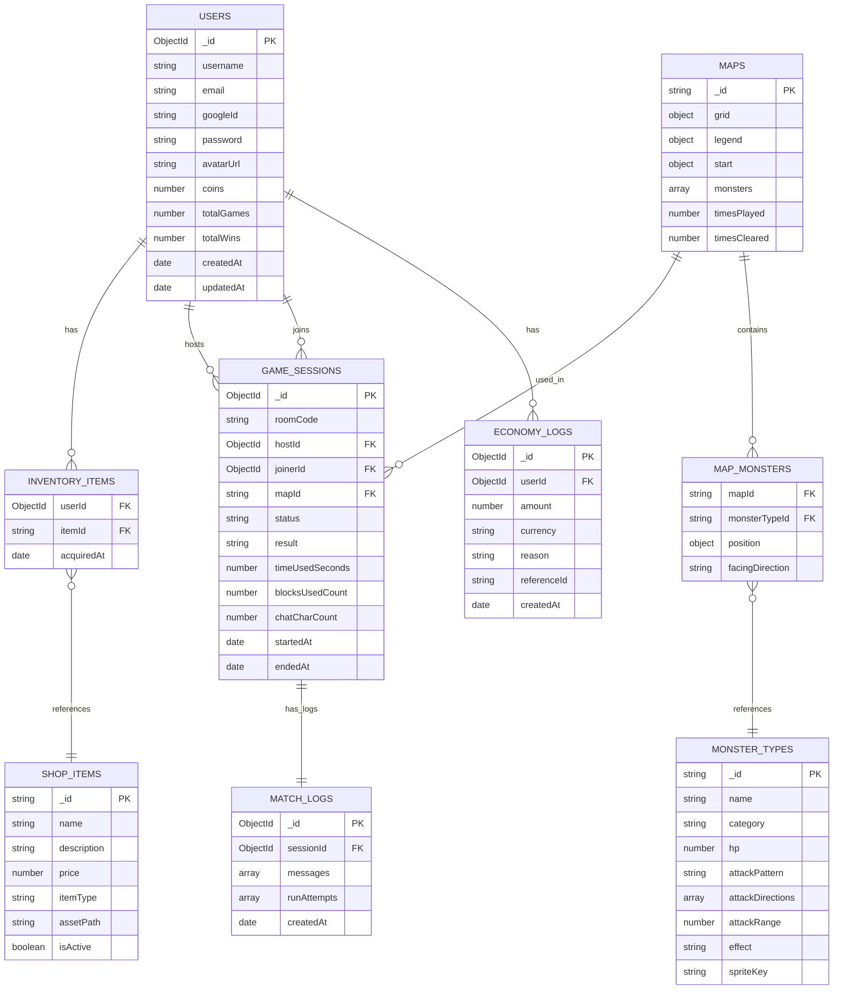

# 🗄️ Database Design — Code in the Dark (Updated)

## 📊 ภาพรวม

- **Database:** MongoDB Atlas (Free Tier — 512MB)
- **ODM:** Mongoose (Node.js)
- **จำนวน Collections:** 7 Collections
- **ความสามารถเสริม:**
  - ปรับปรุงการลดปัญหา Race Condition ด้วย MongoDB Atomic Operations (ไม่พึ่งพาแอปพลิเคชัน Logic)
  - ประหยัดพื้นที่จัดเก็บด้วยระบบ TTL (Time-To-Live) Index สำหรับลบ Log เก่าอัตโนมัติ เพื่อรองรับ Free Tier 512MB ได้อย่างยั่งยืน

---

## 📦 7 Collections และโครงสร้างข้อมูล

---

### 1. 👤 `Users` — ข้อมูลผู้ใช้งาน

**หน้าที่:** เก็บข้อมูลส่วนตัว กระเป๋าเงิน ไอเทมที่ครอบครอง และสถิติการเล่น

| Field              | Type            | หมายเหตุ                                                                     |
| ------------------ | --------------- | ---------------------------------------------------------------------------- |
| `_id`              | ObjectId        | สร้างอัตโนมัติ                                                               |
| `username`         | String          | **Unique Index** ห้ามซ้ำ                                                     |
| `email`            | String          | **Unique Index** ห้ามซ้ำ (ใช้ร่วมกับ Google Login เพื่อระบุผู้ใช้)           |
| `googleId`         | String          | **Unique & Sparse Index** (รหัสประจำตัว Google Account, ค่าเริ่มต้น: `null`) |
| `password`         | String          | **Optional** ควร Hash ก่อนบันทึก (เว้นว่างได้ถ้า Login ผ่าน Google)          |
| `avatarUrl`        | String          | **Optional** เก็บ URL รูปโปรไฟล์ของ Google (ถ้ามี)                           |
| `wallet.coins`     | Number          | ค่าเริ่มต้น = `0`                                                            |
| `inventory`        | Array of Object | `[{ itemId: String, acquiredAt: Date }]`                                     |
| `stats.totalGames` | Number          | จำนวนเกมที่เล่นทั้งหมด                                                       |
| `stats.totalWins`  | Number          | จำนวนเกมที่ชนะ                                                               |
| `createdAt`        | Date            | สร้างอัตโนมัติ (Mongoose timestamps)                                         |
| `updatedAt`        | Date            | สร้างอัตโนมัติ (Mongoose timestamps)                                         |

```json
{
  "_id": "64a1b2c3d4e5f6a7b8c9d0e1",
  "username": "Player1",
  "email": "player1@gmail.com",
  "googleId": "110169485720938475820",
  "password": null,
  "avatarUrl": "https://lh3.googleusercontent.com/a/ALm5wu...",
  "wallet": { "coins": 1500 },
  "inventory": [{ "itemId": "item_001", "acquiredAt": "2026-08-22T10:00:00Z" }],
  "stats": { "totalGames": 20, "totalWins": 15 }
}
```

> [!IMPORTANT]
> **การทำธุรกรรมซื้อไอเทมปลอดภัย 100% (Atomic Operation):**
> แนะนำให้ใช้เงื่อนไขตรวจสอบและอัปเดตแบบอะตอมิก (Atomic Write) บน MongoDB แทนการใช้ Code-level checks เพื่อป้องกันการกดซื้อซ้ำซ้อนโดยไม่มี overhead:
>
> ```typescript
> User.updateOne(
>   { _id: userId, "wallet.coins": { $gte: itemPrice } },
>   {
>     $inc: { "wallet.coins": -itemPrice },
>     $push: { inventory: { itemId, acquiredAt: new Date() } },
>   },
> );
> ```

---

### 2. 🗺️ `Maps` — แคตตาล็อกและสถิติแผนที่

**หน้าที่:** เก็บโครงสร้างแผนที่และสถิติ เพื่อตรวจสอบว่าแมพไหนเคยออกแล้ว และนับความยากของด่าน

| Field              | Type            | หมายเหตุ                                                           |
| ------------------ | --------------- | ------------------------------------------------------------------ |
| `_id`              | String          | กำหนดเอง เช่น `"map_001"` หรือ `"seed_A1B2"`                       |
| `mapData.grid`     | Array 2D        | ตาราง Grid ของด่าน (ตัวเลขแทนประเภท เช่น กำแพง, พื้นว่าง, อุปสรรค) |
| `mapData.legend`   | Object          | ตารางแปลความหมายตัวเลข                                             |
| `mapData.start`    | Object          | `{ x: Number, y: Number }` จุดเริ่มต้น                             |
| `mapData.monsters` | Array of Object | `[{ monsterTypeId, position: {x,y}, facingDirection }]`            |
| `timesPlayed`      | Number          | ถูกสุ่มเจอกี่ครั้ง                                                 |
| `timesCleared`     | Number          | เล่นผ่านกี่ครั้ง (ใช้คำนวณ Win Rate ของด่าน)                       |

```json
{
  "_id": "map_001",
  "mapData": {
    "grid": [
      [4, 4, 4, 4],
      [0, 1, 0, 9],
      [0, 2, 0, 0],
      [3, 0, 4, 0]
    ],
    "legend": {
      "0": "empty",
      "1": "rock",
      "2": "spike",
      "3": "pit",
      "4": "wall",
      "9": "goal"
    },
    "start": { "x": 0, "y": 3 },
    "monsters": [
      {
        "monsterTypeId": "mob_line_shooter",
        "position": { "x": 2, "y": 1 },
        "facingDirection": "left"
      }
    ]
  },
  "timesPlayed": 45,
  "timesCleared": 20
}
```

> [!NOTE]
> เพิ่มรหัส `"4": "wall"` ลงใน `legend` และ `grid` เพื่อระบุตำแหน่งของกำแพงในระบบอย่างถูกต้องตาม Logic ของ Map Generator

---

### 3. 👾 `MonsterTypes` — แคตตาล็อกมอนสเตอร์

**หน้าที่:** เก็บสถิติและความสามารถของมอนสเตอร์แต่ละประเภท เพื่อ Reuse ข้ามหลายแมพ

| Field              | Type            | หมายเหตุ                                              |
| ------------------ | --------------- | ----------------------------------------------------- |
| `_id`              | String          | กำหนดเอง เช่น `"mob_line_shooter"`, `"boss_guardian"` |
| `name`             | String          | ชื่อมอนสเตอร์                                         |
| `category`         | String          | `"normal"` หรือ `"boss"`                              |
| `hp`               | Number          | Normal = `1`, Boss = `2` ขึ้นไป                       |
| `attackPattern`    | String          | `"linear"` (เส้นตรง) หรือ `"radial"` (รอบทิศทาง)      |
| `attackDirections` | Array of String | `["up", "down", "left", "right"]`                     |
| `attackRange`      | Number          | ระยะโจมตี (จำนวนช่อง)                                 |
| `effect`           | String          | `"send_to_start"` (ผลกระทบเมื่อผู้เล่นโดน)            |
| `spriteKey`        | String          | คีย์สำหรับดึง Asset สกินมอนสเตอร์มาวาดบนบอร์ดเกม      |

```json
[
  {
    "_id": "mob_line_shooter",
    "name": "Line Shooter",
    "category": "normal",
    "hp": 1,
    "attackPattern": "linear",
    "attackDirections": ["up", "down", "left", "right"],
    "attackRange": 3,
    "effect": "send_to_start",
    "spriteKey": "spr_mob_line_shooter"
  }
]
```

---

### 4. 🏪 `ShopItems` — แคตตาล็อกสินค้าในร้านค้า

**หน้าที่:** เก็บข้อมูลสินค้าทั้งหมดในระบบ

| Field         | Type    | หมายเหตุ                                                                                               |
| ------------- | ------- | ------------------------------------------------------------------------------------------------------ |
| `_id`         | String  | กำหนดเอง เช่น `"item_001"`                                                                             |
| `name`        | String  | ชื่อไอเทม                                                                                              |
| `description` | String  | คำอธิบายไอเทม                                                                                          |
| `price`       | Number  | ราคา (coins)                                                                                           |
| `itemType`    | String  | `"avatar_skin"`, `"emoji"`, `"profile_frame"`                                                          |
| `assetPath`   | String  | ที่อยู่ไฟล์รูปภาพ หรือ รหัสไอเซทที่จะแสดงผล (เช่น `"/skins/hacker.png"`)                               |
| `isActive`    | Boolean | `true` = เปิดขาย, `false` = ปิดขาย (ใช้การ deactivate แทนการลบ เพื่อไม่ให้ไอเทมใน User Inventory บั๊ก) |

```json
{
  "_id": "item_001",
  "name": "Neon Hacker Skin",
  "description": "สกินตัวละครเรืองแสงในความมืด",
  "price": 500,
  "itemType": "avatar_skin",
  "assetPath": "/skins/hacker.png",
  "isActive": true
}
```

---

### 5. 🎮 `GameSessions` — ประวัติการเล่นภาพรวม (ต่อห้อง)

**หน้าที่:** เก็บข้อมูลระดับสูงของแต่ละรอบการเล่น ใช้สำหรับ Match History และ Leaderboard

| Field                         | Type     | หมายเหตุ                                                        |
| ----------------------------- | -------- | --------------------------------------------------------------- |
| `_id`                         | ObjectId | สร้างอัตโนมัติ                                                  |
| `roomCode`                    | String   | **Index** รหัสห้อง 6 หลัก                                       |
| `hostId`                      | ObjectId | **Index** โยงไป `Users`                                         |
| `joinerId`                    | ObjectId | **Index** โยงไป `Users` (ค่าเริ่มต้น: `null`)                   |
| `mapId`                       | String   | โยงไป `Maps` (ค่าเริ่มต้น: `null`)                              |
| `status`                      | String   | **Index** `"waiting"`, `"playing"`, `"finished"`, `"abandoned"` |
| `gameMetrics.result`          | String   | `"success"` หรือ `"failed"` (default: `null`)                   |
| `gameMetrics.timeUsedSeconds` | Number   | เวลาที่ใช้ไป (default: `0`)                                     |
| `gameMetrics.blocksUsedCount` | Number   | จำนวนบล็อกที่ใช้ (default: `0`)                                 |
| `gameMetrics.chatCharCount`   | Number   | จำนวนตัวอักษรที่แชท (default: `0`)                              |
| `startedAt`                   | Date     | เวลาเริ่มสร้างห้อง                                              |
| `endedAt`                     | Date     | เวลาจบเกม (default: `null`)                                     |

> [!NOTE]
> เพิ่มสถานะ `"abandoned"` ในส่วนของ `status` สำหรับห้องที่ไม่มีการเล่นจนเสร็จ (เช่น โฮสต์ปิดหน้าเว็บหนี หรือไม่มีคนมาแจม) ป้องกันการมีห้องค้างในระบบ

---

### 6. 💬 `MatchLogs` — ประวัติแชทและการรันโค้ด

**หน้าที่:** เก็บข้อมูลหนักแยกออกจาก GameSessions เพื่อประสิทธิภาพในการโหลด Match History

| Field         | Type            | หมายเหตุ                                                          |
| ------------- | --------------- | ----------------------------------------------------------------- |
| `_id`         | ObjectId        | สร้างอัตโนมัติ                                                    |
| `sessionId`   | ObjectId        | โยงไป `GameSessions` (ความสัมพันธ์ 1:1)                           |
| `messages`    | Array of Object | `[{ sender, text, timestamp }]`                                   |
| `runAttempts` | Array of Object | `[{ blocks[], success, timestamp }]`                              |
| `createdAt`   | Date            | **TTL Index** ค่าเริ่มต้น `Date.now` ลบข้อมูลอัตโนมัติหลังหมดอายุ |

```json
{
  "_id": "64b1c2d3e4f5a6b7c8d9e0f1",
  "sessionId": "64f9a1b2c3d4e5f6a7b8c9d0",
  "messages": [
    {
      "sender": "Player1",
      "text": "เดินขวา 3 ก้อนเลย!",
      "timestamp": "2026-08-22T10:00:15Z"
    }
  ],
  "runAttempts": [
    {
      "blocks": ["FORWARD", "RIGHT"],
      "success": true,
      "timestamp": "2026-08-22T10:01:45Z"
    }
  ],
  "createdAt": "2026-08-22T10:00:00Z"
}
```

> [!WARNING]
> **ระบบล้างขยะอัตโนมัติ (TTL Index):**
> กำหนดให้สร้าง TTL Index บนฟิลด์ `createdAt` โดยกำหนดช่วงเวลาหมดอายุไว้ที่ 30 วัน (`expireAfterSeconds: 2592000`) ข้อมูลล็อกการเล่นอย่างละเอียดตัวนี้จะถูกลบทิ้งอัตโนมัติ ช่วยรักษาพื้นที่เก็บข้อมูลไม่ให้เกินขีดจำกัดของ Free Tier (512MB)

---

### 7. 💰 `EconomyLogs` — ประวัติธุรกรรมการเงิน (Statement)

**หน้าที่:** บันทึกทุกการได้/เสียเงิน เพื่อ Audit Trail และป้องกันปัญหาเงินหาย/บั๊ก

| Field         | Type     | หมายเหตุ                                      |
| ------------- | -------- | --------------------------------------------- |
| `_id`         | ObjectId | สร้างอัตโนมัติ                                |
| `userId`      | ObjectId | **Index** โยงไป `Users`                       |
| `amount`      | Number   | `+50` = ได้เงิน, `-500` = เสียเงิน            |
| `currency`    | String   | `"coins"`                                     |
| `reason`      | String   | `"win_reward"`, `"buy_item"`                  |
| `referenceId` | String   | อ้างอิง Session ID หรือ Item ID ที่เกี่ยวข้อง |
| `createdAt`   | Date     | **Index** สร้างอัตโนมัติ                      |

---

## 🗺️ ER Diagram (ความสัมพันธ์ระหว่าง Collections)



## ⚙️ Indexes ที่ต้องสร้าง

| Collection     | Field                        | ประเภท              | เหตุผล                                                        |
| -------------- | ---------------------------- | ------------------- | ------------------------------------------------------------- |
| `Users`        | `username`                   | Unique              | ห้ามชื่อซ้ำ                                                   |
| `Users`        | `email`                      | Unique              | ป้องกันการลงทะเบียน Email ซ้ำซ้อน                             |
| `Users`        | `googleId`                   | **Unique & Sparse** | ตรวจสอบการผูกบัญชี Google (รองรับค่า null สำหรับผู้ใช้ทั่วไป) |
| `GameSessions` | `{ roomCode: 1, status: 1 }` | **Compound**        | ค้นหาห้องตอน Join (คัดกรองเฉพาะห้องที่ยังไม่เริ่มเล่น)        |
| `GameSessions` | `hostId`                     | Normal              | ดูประวัติการเล่นของผู้เล่นที่เป็น Host                        |
| `GameSessions` | `joinerId`                   | Normal              | ดูประวัติการเล่นของผู้เล่นที่เป็น Joiner                      |
| `MatchLogs`    | `createdAt`                  | **TTL Index**       | ลบ log ประวัติการเล่นที่เกิน 30 วันอัตโนมัติ                  |
| `EconomyLogs`  | `userId`                     | Normal              | ดูประวัติเงินของผู้เล่น                                       |
| `EconomyLogs`  | `createdAt`                  | Normal              | เรียงลำดับประวัติการเงินตามเวลาล่าสุด                         |

---

## ✅ สรุปการปรับปรุงเพิ่มประสิทธิภาพ

1. **Atomic Shopping Transaction**: ตัด Logic การเช็คเงินและเวอร์ชันในแอปทิ้ง หันมาอัปเดตแบบ Atomic (`$inc` คู่กับเงื่อนไข `$gte` ใน Query) ป้องกันเงินติดลบและการกดสั่งซ้ำซ้อนได้อย่างสมบูรณ์แบบ
2. **TTL Index for match log**: จัดการ MatchLogs ให้ลบตัวเองอัตโนมัติใน 30 วัน เพื่อคงสภาพความจุ MongoDB Atlas Free Tier ให้เหลือเกินพอสำหรับเก็บข้อมูลหลักอย่าง `Users` และ `GameSessions`
3. **Legend Completion**: เพิ่มค่า `4: wall` ใน Maps Legend เพื่อให้สอดรับกับตำแหน่งกำแพงที่สุ่มขึ้นมา
4. **Room Joining Optimization**: ทำ Compound Index `roomCode + status` เพื่อสืบค้นข้อมูลรหัสห้องที่ยัง "รอผู้เล่นคนอื่นเข้าร่วม" ได้แบบเร็วที่สุด
5. **Robust State Flow**: เพิ่มสถานะ `"abandoned"` ป้องกันข้อมูลตกค้างใน GameSessions ในกรณีที่ผู้เล่นหลุดออกจากระบบหรือออกจากเกมกะทันหัน
